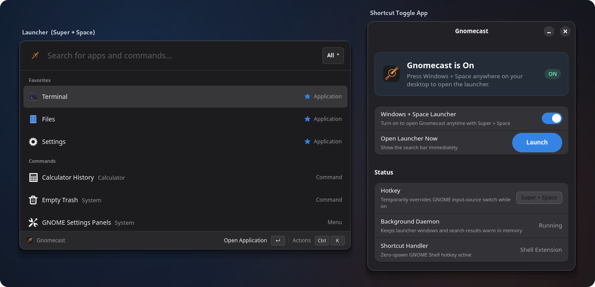
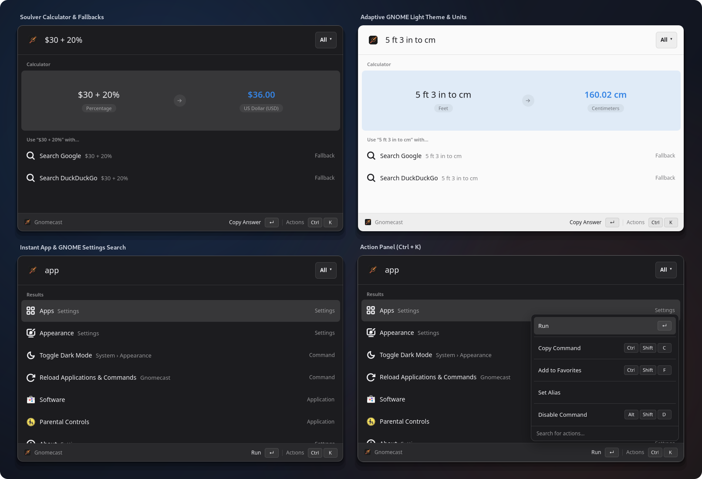

<p align="center">
  
</p>

<h1 align="center">Gnomecast</h1>

<p align="center">
  A fast, keyboard-first Raycast-style launcher for <strong>GNOME</strong> on Linux (Fedora RPM, Debian/Ubuntu DEB, and more).<br>
  By <a href="https://github.com/ismeetxd">ismeetxd</a>
</p>

<p align="center">
  
</p>

## What works

Built by [ismeetxd](https://github.com/ismeetxd), Gnomecast brings a native, low-latency command palette to **GNOME on Linux (Fedora, Debian, Ubuntu, and beyond)** via a persistent GTK4 + Libadwaita daemon (`dev.ismeetxd.Gnomecast`) and a companion GNOME Shell extension (`gnomecast@ismeetxd.dev`):

- **Apps & GNOME system commands.** Desktop entries, GNOME Settings panels, Toggle Dark Mode, Toggle Night Light, Power Profiles, power actions (Lock Screen, Suspend, Log Out, Restart, Shut Down), and Empty Trash (handled safely without Linuxbrew GVfs conflicts). Pressing Enter focuses an already-running app or launches a new instance (`Shift+Enter` always opens a new window).
- **Super+Space / Windows+Space launcher & Toggle App.** A dedicated **Gnomecast** Settings app (`gnomecast app`) lets you toggle **Windows + Space (`Super+Space`)** cleanly **ON** or **OFF** while backing up and restoring GNOME's input-source switch shortcut automatically.
- **Root search with frecency, aliases & favorites.** Launches bump frecency (10-day half-life), typos tolerate one or two mistakes (`Search Sensitivity`), pinned favorites sit at the top, and custom aliases go straight to the top match.
- **Action panel & shortcuts.** `Ctrl+K` for alternate actions, `Ctrl+1`–`9` shortcuts, `Ctrl+P` root filter dropdown (`All` / `Applications` / `Commands`), `Ctrl+T` toast actions, `Ctrl+Shift+K` metadata panel, `Enter` confirms alerts, and adaptive Dark/Light Adwaita themes.
- **Built-in calculator.** Arithmetic, Soulver percentages (`$30 + 20%`, `20% off 50`), ~250 unit conversions (`5 ft 3 in to cm`, `60 mph * 2 h`), currency conversion (ECB rates), dates, time zones (`time in tokyo`), number bases (`255 to hex`), Unix timestamps, and persistent **Calculator History**.
- **Argument pills & fallbacks.** Commands like *Search Google* and *Search DuckDuckGo* accept inline query pills (`Tab` to enter). Unmatched queries fall back directly to web search.

<p align="center">
  
</p>

## Installation (RPM, DEB & Source)

Gnomecast supports all modern GNOME desktop environments (Wayland and X11) and provides native packages for **Fedora / RHEL (`.rpm`)** and **Debian / Ubuntu (`.deb`)**, as well as a direct user install from source.

### Package dependencies

- **Fedora / RHEL (RPM):** `gjs`, `gtk4`, `libadwaita`, `systemd`, `jq`, `wl-clipboard`, `libnotify`, `glib2`
- **Debian / Ubuntu (DEB):** `gjs`, `gir1.2-gtk-4.0`, `gir1.2-adw-1`, `systemd`, `jq`, `wl-clipboard`, `libnotify-bin`, `libglib2.0-bin` (or `glib-bin`)

### Install via RPM or DEB

Install the built package for your distribution:

```sh
# Fedora / RHEL (.rpm)
sudo dnf install ./dist/gnomecast-*.rpm

# Debian / Ubuntu (.deb)
sudo apt install ./dist/gnomecast_*_amd64.deb
```

Then configure the hotkey:
```sh
gnomecast setup              # binds Super+Space (Windows+Space) to toggle Gnomecast
gnomecast doctor             # verifies daemon, icons, Trash helper, extension & Super+Space
```

### Install from source

Clone and install Gnomecast directly into your user session:

```sh
git clone https://github.com/ismeetxd/gnomecast.git
cd gnomecast
./bin/gnomecast install            # builds helper, installs app logo & icons, extension, D-Bus & systemd daemon
./bin/gnomecast setup              # binds Super+Space (Windows+Space) to toggle Gnomecast
./bin/gnomecast doctor             # verifies daemon, icons, Trash helper, extension & Super+Space
```

### Building RPM & DEB packages

You can generate `.rpm` and `.deb` distribution packages directly:

```sh
gnomecast package deb              # builds Debian/Ubuntu .deb (works natively on Fedora with ar + tar)
gnomecast package rpm              # builds Fedora .rpm (requires rpm-build)
gnomecast package all              # builds both packages into dist/
```

Open **Gnomecast** from your GNOME app grid (or run `gnomecast app`) at any time to flip **Windows + Space (`Super+Space`)** **ON** or **OFF** without touching terminal commands.

> [!NOTE]
> Log out and log back in once after first install on Wayland so GNOME Shell loads the companion extension (`gnomecast@ismeetxd.dev`) for sub-millisecond `Super+Space` triggering and window focus tracking. Before logging out, Gnomecast automatically configures GNOME custom keybindings so `Super+Space` works immediately.

### Uninstall

```sh
gnomecast uninstall
```

Removes desktop entries, hicolor icons, D-Bus activation, the `gnomecast.service` user unit, companion extension, CLI symlink, and offers to restore GNOME's default `Super+Space` input-source binding. Your data stays under `~/.config/gnomecast`, `~/.local/share/gnomecast`, `~/.cache/gnomecast`, and `~/.local/state/gnomecast` until deleted.

## Privacy & requirements

- **Zero argv leaks.** Queries, calculator expressions, copied answers, and URLs are never placed on process command lines; clipboard transfers read from `stdin`.
- **Private directories and stores.** Config, data, cache, and state directories under `~/.config/gnomecast`, `~/.local/share/gnomecast`, `~/.cache/gnomecast`, and `~/.local/state/gnomecast` are created `0700` with `0600` JSON store files.
- **Daily currency cache.** Online currency conversions fetch daily ECB rates once from [frankfurter.dev](https://www.frankfurter.dev) and cache them in `~/.cache/gnomecast/currencies.json` — the only network request Gnomecast makes. Disable it by setting `"currencyRates": false` in `~/.config/gnomecast/config.json`.
- **Optional Rust search helper.** When `cargo` is present, `gnomecast install` (or `gnomecast build-search`) compiles `bin/gnomecast-search` (`search/`) for asynchronous typo-tolerant matching. Otherwise Gnomecast falls back automatically to the built-in JS matcher.
- **Safe Trash emptying.** On systems with Linuxbrew in `systemd --user`'s `PATH` (where Homebrew's `gio` lacks GVfs modules), Gnomecast explicitly uses `/usr/bin/gio trash --empty` with safe `NOFOLLOW_SYMLINKS` fallback so **Empty Trash** works reliably without touching targets outside Trash.

## CLI

```sh
gnomecast toggle | show | hide
gnomecast app                         # open Super+Space toggle window
gnomecast hotkey <on|off|toggle|status>
gnomecast run <commandId>             # e.g. app:org.mozilla.firefox, gnome:system.empty-trash
gnomecast call <method> [json]        # call any backend RPC method
gnomecast package [deb|rpm|all]       # generate Debian/Ubuntu .deb or Fedora .rpm packages
gnomecast doctor
```

## Contributing

```sh
git clone https://github.com/ismeetxd/gnomecast.git
cd gnomecast
bin/gnomecast install                 # install from dev checkout
node --test tests/*.test.js           # core unit & privacy suite
gjs -m tests/gnome-check.js           # GNOME backend, NativeSearch & Empty Trash suite
tests/smoke.sh                        # live IPC & <100 ms latency checks
```

See [`CLAUDE.md`](CLAUDE.md) for architecture notes, specs, and conventions.

## Credits & License

- **Created & maintained by [ismeetxd](https://github.com/ismeetxd)**

MIT License — see [`LICENSE`](LICENSE). Gnomecast is an independent, clean-room project, not affiliated with or endorsed by Raycast, and contains no Raycast code, assets, or telemetry.
